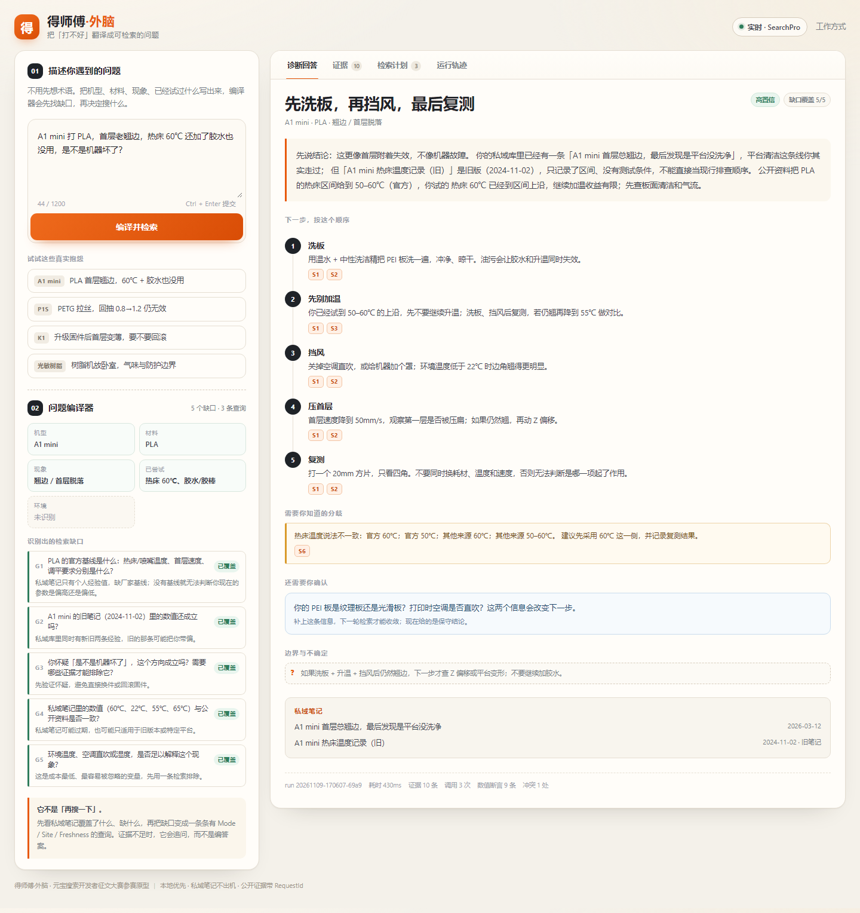
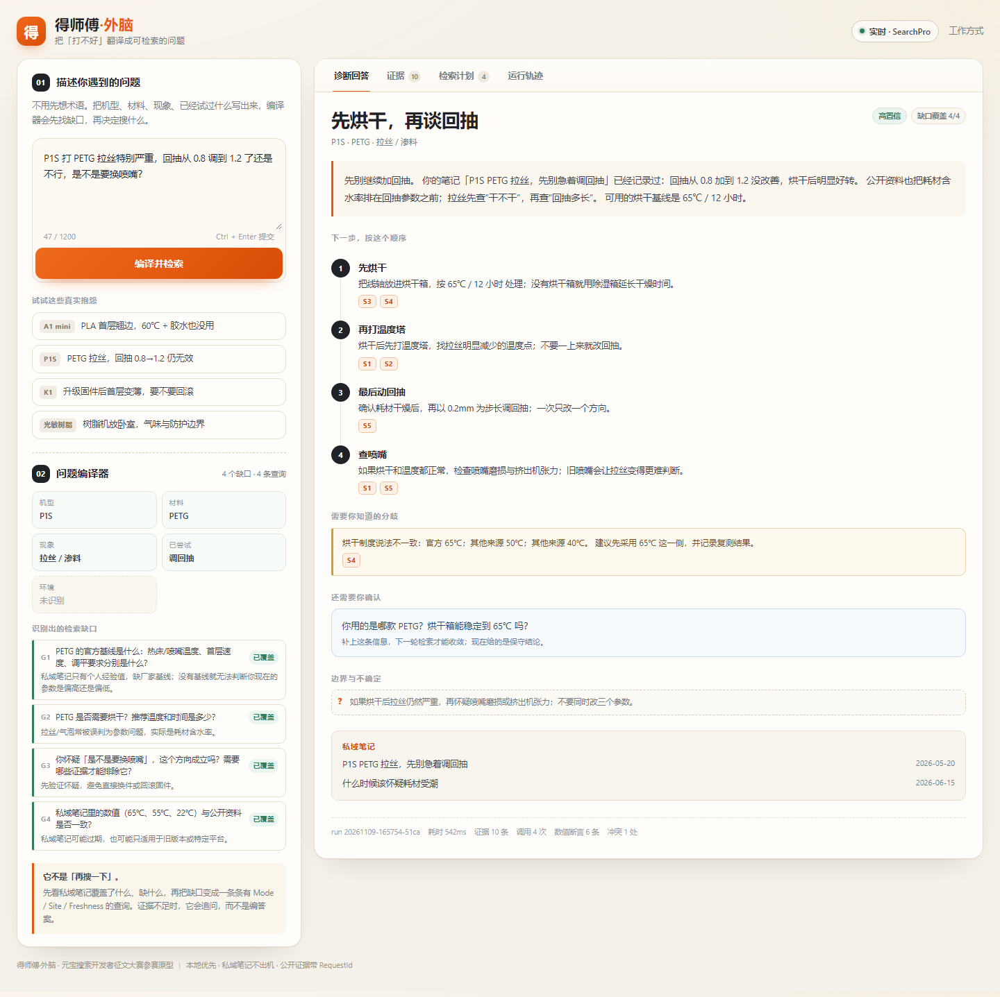
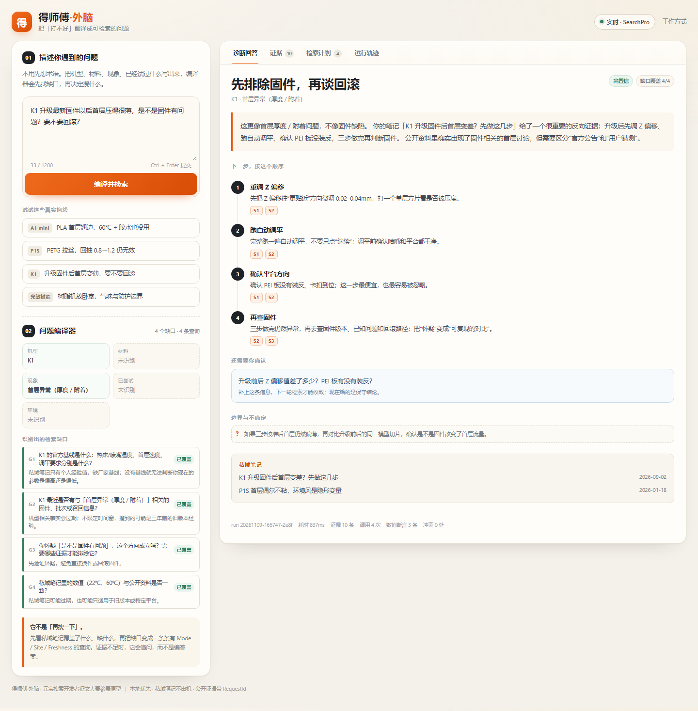
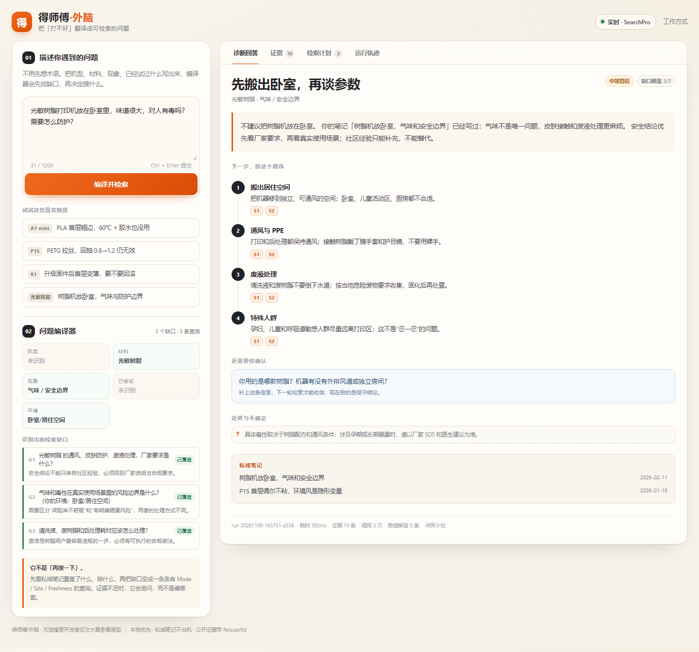

# 【元宝搜索开发者征文大赛】把「打不好」翻译成可检索的问题：得师傅·外脑 × 元宝 SearchPro 实战

> 赛道：模型智答与产品问答（公网信息 + 私域知识混合问答）
> 阶段：可演示原型
> 说明：本文在 AI 辅助下完成资料梳理与文字润色；代码、运行结果与截图均由本地工程实际跑出。AI 没有替代对证据、数值与边界的核对。

---

## 0. 先说结论

3D 打印新手最常说的一句话是：

> 「A1 mini 打 PLA，首层老翘边，热床 60℃ 还加了胶水也没用，是不是机器坏了？」

这句话里其实藏着五个问题：官方基线是多少？我的旧笔记还成立吗？「机器坏了」这个怀疑该怎么排除？胶水为什么无效？空调直吹算不算变量？

直接把这句原话丢给搜索引擎，会得到一坨「看起来相关」的页面；直接丢给大模型，会得到一段「听起来合理」但没有出处的建议。

我做的「得师傅·外脑」不急着回答。它先做一件事：**把这句抱怨编译成一张有类型的检索任务书**，再用元宝搜索 SearchPro 去补私域知识缺口，最后把证据、冲突、边界和下一步一起交出来。

一句话：**先学会问，再学会答。**



---

## 1. 为什么又把旧项目翻出来

「得师傅」原本是一个本地优先的 3D 打印工艺向导：Tauri 2.x + React + Rust，SQLite FTS5 做私域笔记检索，可选 sqlite-vec 混合检索，内置厂家工程师、打印导师、选机顾问三个角色。它此前在社区赛事中获过奖。

这次为了参赛，我把它拆成一个可独立运行的外脑 sidecar，并准备了一组贴近真实使用场景的**演示笔记**。本文里的私域笔记和四个案例是合成的（`data/kb_seed.json`），不含任何真实用户数据；公网页面来自真实的 SearchPro 调用。文中的界面截图拍于 2026-11-09，`version=lite`，每次调用的 RequestId 都落在 `runs/demo_check.json` 与界面「运行轨迹」里。

但它有一个绕不过去的边界：**私域笔记是小的、旧的、会互相矛盾的。**

比如演示库里同时躺着两条 A1 mini 笔记：

- 2026-03-12：「首层总翘边，最后发现是平台没洗净」——有效经验；
- 2024-11-02：「PLA 热床 50–60℃」——旧版参数，已经偏保守。

如果只做私域 RAG，模型会把两条笔记一起召回，然后给出一个「50–60℃ 也可以，洗板也行」的平均答案。这个答案不错，但它没有回答用户真正需要的：**2025 年的 A1 mini，官方基线到底是多少？**

这就是元宝搜索该进来的位置：不是替代私域，而是**在私域不够的那一刻，补上公网证据**。

而「什么时候算不够」，不能靠感觉，要先把缺口列出来。

---

## 2. 把「提问」做成一个编译器

「问题编译器」是整个项目最核心的部分。它不生成答案，只生成四样东西：

### 2.1 槽位：先把人话拆成结构

```json
{
  "model": "A1 mini",
  "material": "PLA",
  "symptom": "warping",
  "tried": ["热床 60℃", "胶水/胶棒"],
  "environment": [],
  "intent": {"freshness": false, "safety": false}
}
```

槽位不是为了「显得智能」，而是为了后面能判断：哪些信息已经有了，哪些还缺，哪些必须问用户。

### 2.2 缺口：把「不知道」写成可验收的问题

每条缺口都长这样：

```json
{
  "id": "G1",
  "type": "official_parameter",
  "question": "PLA 的官方基线是什么：热床/喷嘴温度、首层速度、调平要求分别是什么？",
  "why": "私域笔记只有个人经验值，缺厂家基线；没有基线就无法判断你现在的参数是偏高还是偏低。",
  "action": "search"
}
```

这一步是「提出问题比解决问题更重要」的工程化：**缺口必须有 id、有问法、有为什么问、有谁来答。** 没有这四样，搜索就会退化成「再搜一下」。

A1 mini 案例最终生成了 5 个缺口：

| 缺口 | 类型 | 它真正想问的 |
|---|---|---|
| G1 | official_parameter | 官方热床/喷嘴/首层速度基线是多少 |
| G2 | stale_private_note | 2024 年的旧笔记还成立吗 |
| G3 | rule_out | 「是不是机器坏了」这个怀疑该怎么排除 |
| G4 | verify_conflict | 私域数值和公开资料是否一致 |
| G5 | environment | 空调直吹/环境温度算不算变量 |

### 2.3 任务书：每条 query 都有目的和验收标准

编译器不会只生成一句「A1 mini 翘边怎么办」。它生成的是这样一张表：

| Q | 查询 | 参数 | 目的 | 覆盖 |
|---|---|---|---|---|
| Q1 | A1 mini PLA 官方 参数 热床 喷嘴 温度 | Mode=2, Cnt=10, Site=wiki.bambulab.com | 拿厂家基线，校准私域经验 | G1/G2/G4 |
| Q2 | A1 mini PLA 首层 翘边 附着 原因 热床 60℃ 胶水/胶棒 无效 其他原因 | Mode=2, Cnt=10 | 验证已试过的方向为什么无效 | G3 |
| Q3 | 3D打印 翘边 / 首层脱落 环境 温度 空调 直吹 | Mode=2, Cnt=10 | 用低成本检索排除环境变量 | G5 |

注意三个细节：

1. **Q1 带 `Site`**：官方基线优先从厂家 wiki 拿，不让社区帖子先入为主。
2. **Q2 把「已试过什么」写进查询**：不是搜「翘边怎么办」，而是搜「60℃ + 胶水都无效，还有什么原因」。这是「反向证据」检索。
3. **Q3 的权重最低**：环境变量便宜、容易被忽略，用一条 query 排除即可，不值得花三次调用。

### 2.4 证据：不是「搜到就算」，而是「能对上才算」

SearchPro 返回的页面会经过：

- URL 去重；
- 来源分层（官方 / 社区 / 一般网页 / 低质）；
- 新鲜度折算；
- 数值断言抽取（热床温度、喷嘴温度、烘干条件、回抽、速度）；
- 冲突检测（官方区间/单点 vs 社区值，按来源逐个列出）；
- 缺口覆盖率判定（covered / partial / insufficient / need_user）。

最后回答里的每一步都挂 `S1`、`S2` 这样的编号，点一下就能跳到证据卡。**没有编号的结论不写。**

---

## 3. 接入元宝 SearchPro：两条鉴权路径与四个坑

SearchPro 有两条接入路径，我按文档把两条都实现了：

### 路径 A：服务 API KEY

```http
POST https://api.wsa.cloud.tencent.com/SearchPro
Authorization: Bearer sk-...
Content-Type: application/json; charset=UTF-8
```

适合快速验证，代码里就是一个 header。

### 路径 B：腾讯云 TC3-HMAC-SHA256

```http
POST https://wsa.tencentcloudapi.com/
X-TC-Action: SearchPro
X-TC-Version: 2025-05-08
X-TC-Timestamp: ...
```

需要 `SecretId` / `SecretKey`，按腾讯云规范拼 canonical request、string-to-sign 和签名。两个坑：

- **日期用 UTC**，不是本地时间；
- **string-to-sign 里的 timestamp 是 Unix 秒字符串**，不是格式化时间。

### 坑 1：`Pages` 是「字符串数组」，要二次解析

返回结构大概长这样：

```json
{
  "Response": {
    "Pages": [
      "{\"title\":\"...\",\"url\":\"...\",\"passage\":\"...\"}",
      "{\"title\":\"...\",\"url\":\"...\"}"
    ],
    "RequestId": "..."
  }
}
```

`Pages` 的每个元素本身是一段 JSON 字符串，不是对象。按常见的 `page["title"]` 写法会直接报字符串下标错误；正确做法是 `json.loads(page)` 再取字段。这是文档里最容易被扫过去的一行。

### 坑 2：`Cnt` 只接受 10/20/30/40/50

传 `Cnt=8` 不会「帮你取 8 条」，而是参数错误。客户端里做了白名单，非法的值直接回落到 10。

### 坑 3：`Site` 过滤会把召回打到 0

官方站点过滤很好用，但不是每个 query 都有官方页面。我的处理是：

1. 先带 `Site` 搜；
2. 如果失败或 0 结果，去掉 `Site` 重试；
3. 在 trace 里标 `fallback=site_filter_removed`。

**不假装没发生。** 评审或读者看 trace 时，能明确知道这条证据是「降级召回」来的。

### 坑 4：`score` 的量纲会漂

文档写 score 是 0–1，但社区先行者的接入记录里，不同 `Mode` / `Industry` 下会出现大于 1 的值（见文末参考中的 SearchPro 接入记录）。我的选择是：**不把 raw score 当唯一排序依据**，而是用自己的「相关度 + 来源层级 + 新鲜度 + 权威度」加权。SearchPro 的 score 只作为相关度的一个输入。

另外两个参数很关键：

- `Freshness`：查固件/批次问题时用 `m6`，避免拿到三年前的旧教程；
- `Industry`：安全/合规类问题用 `gov`，把官方安全要求顶上来。

---

## 4. 四个可复现案例

### 4.1 A1 mini：旧笔记 vs 官方基线

用户原话：

> A1 mini 打 PLA，首层老翘边，热床 60℃ 还加了胶水也没用，是不是机器坏了？

编译器抽出的关键矛盾：

- 私域旧笔记：PLA 热床 50–60℃（写于 2024-11-02）；
- 当前官方 A1 页面：PLA 热床 50–60℃（Bambu Wiki）；
- 同一官方 Wiki 的翘曲排查页：建议把热床降到 50℃ 再试。

旧笔记的数值并不离谱，甚至和当前官方区间一致；问题在于它只有区间、没有测试条件，也没有给出「60℃ 之后试什么」。真正的矛盾是：用户已经试到 60℃，这正好是官方上沿，再升温就是无效动作。

最终回答：

> **先洗板，再挡风，最后复测。**
> 这更像首层附着失效，不像机器故障。平台清洁这条线你其实走过；但「A1 mini 热床温度记录（旧）」写于 2024-11-02，只记录了区间、没有测试条件，不能直接当现行排查顺序。公开资料把 PLA 热床给到 50–60℃（官方），你试的 60℃ 已经到上沿，继续加温收益有限；先查板面清洁和气流。

回答里做了三件事：

1. **不静默平均**：把「官方 60℃；官方 50℃；其他来源 60℃；其他来源 50–60℃」逐条列出，回答取官方区间，不取单点；
2. **解释旧笔记**：明确说 2024-11-02 的笔记只有区间、没有测试条件；它和官方区间一致，所以不是「数值错了」，而是不足以指导下一步；
3. **给行动顺序**：洗板 → 挡风 → 复测 →（仍翘才）压首层，每步只改一个变量。注意第二步不是「继续升温」——编译器判断用户已经到上沿，把这一步改成了「先别加温」。

### 4.2 P1S：用户想换喷嘴，真正该做的是烘干

用户原话：

> P1S 打 PETG 拉丝特别严重，回抽从 0.8 调到 1.2 了还是不行，是不是要换喷嘴？

用户已经有一个强假设：换喷嘴。但私域笔记里其实记录了「回抽 0.8→1.2 无效，65℃ 烘 4 小时好转」。live 这一轮，编译器用 4 条查询拿到了 Bambu 官方《耗材烘干操作指南》，表格里明确写着 `PETG、PETG-CF 推荐 65℃, 12H`。

最终回答：

> **先烘干，再谈回抽。**
> 你的笔记已经记录过：回抽从 0.8 加到 1.2 没改善，烘干后明显好转。公开资料也把耗材含水率排在回抽参数之前；拉丝先查「干不干」，再查「回抽多长」。可用的烘干基线是 65℃ / 12 小时。

回答里同时列了分歧：官方 65℃；其它来源 50℃、40℃。系统没有把三个数平均成 52℃，而是把官方值作为首选，把其它值留在「需要你知道的分歧」里。

这一轮还踩到一个很具体的表格坑：官方页在 PETG 行之前有一行 `Support for PLA/PETG 推荐 60℃, 12H`。第一版抽取器把「60℃」也算成了 PETG 的 official claim，回答一度写成「60℃ / 12 小时」。修复方式不是调排序，而是在 claim 抽取时跳过 `Support / 支撑` 这种支撑材料窗口。最终才落到 PETG 的 65℃。



这就是「提问编译器」的价值：它没有直接回答「要不要换喷嘴」，而是先判断**这个问题本身是不是问错了**。

### 4.3 K1：用户想回滚固件，先找反向证据

用户原话：

> K1 升级最新固件以后首层压得很薄，是不是固件有问题？要不要回滚？

这是一个典型的「强假设 + 高代价动作」：回滚固件可能变砖，也可能白忙。编译器生成了 4 条查询，其中两条带 `Freshness=m6`，专门查最近半年的固件讨论。

这一轮 live 拿到 10 条证据、4 条官方来源、3 条数值断言、0 处冲突。公开资料里确实出现了固件相关的首层讨论，但官方发布说明没有承认这是普遍缺陷；私域笔记给的反向证据是：升级后先调 Z 偏移、跑自动调平、确认 PEI 板没装反，三步做完再判断固件。

最终回答：

> **先排除固件，再谈回滚。**
> 这更像首层厚度/附着问题，不像固件缺陷。先把 Z 偏移往「更贴近」方向微调 0.02–0.04mm，跑一遍完整调平，确认 PEI 板方向；三步做完仍然异常，再去查固件版本和回滚路径。

注意：3 条数值断言没有一条能证明「固件缺陷」，所以回答把回滚放在最后。编译器没有为了「显得有内容」硬凑参数，而是把「先做什么、什么情况下才回滚」讲清楚。

### 4.4 光敏树脂：安全类问题不能只靠社区

用户原话：

> 光敏树脂打印机放在卧室里，味道很大，对人有毒吗？需要怎么防护？

安全类问题有三个特殊要求：

1. 必须优先官方/权威来源；
2. 必须覆盖「防护」和「废液」两个动作；
3. 不能把「闻起来不舒服」直接等同于「明确健康风险」。

编译器生成了 3 条查询：官方安全说明、职业健康机制、废液合规章节。最终回答：

> **先搬出卧室，再谈参数。**
> 不建议把树脂机放在卧室。气味不是唯一问题，皮肤接触和废液处理更麻烦。把机器移到独立、可通风的空间；接触树脂戴丁腈手套和护目镜；清洗液和废树脂不要倒下水道。

边界也写清楚了：具体毒性取决于树脂配方和通风条件；涉及孕期或长期暴露，以厂家 SDS 和医生建议为准。

这一轮 live 也暴露了系统的短板：10 条证据里 **0 条官方来源**，全是社区和媒体页面，所以置信度被压到 **medium**。回答只保留「搬出卧室 / 通风 / PPE / 废液」这些跨来源一致的边界，没有把「有毒吗」升级成确定结论。这比硬给一个「有/没有」更诚实，也说明下一步需要补官方 SDS 与监管来源。





---

## 5. 验证：怎么知道它不是「看起来能跑」

我写了一个 `bench.py`，把四个案例跑完整链路，输出一张可复现的表。下面是 2026-11-09 17:05 起的 **live** 结果（`WSA_MODE=live`，`version=lite`，`replayed=False`）：

| 案例 | 查询 | 证据 | 官方 | 数值断言 | 冲突 | 缺口覆盖 | 有引用步骤 | 置信 |
|---|---:|---:|---:|---:|---:|---:|---:|---|
| A1 mini | 3 | 10 | 3 | 9 | 1 | 5/5 | 5/5 | high |
| P1S | 4 | 10 | 5 | 6 | 1 | 4/4 | 4/4 | high |
| K1 | 4 | 10 | 4 | 3 | 0 | 4/4 | 4/4 | high |
| 光敏树脂 | 3 | 10 | 0 | 0 | 0 | 3/3 | 4/4 | medium |

四个案例合计：**14 次 SearchPro 调用、40 条证据、12 条官方来源、18 条数值断言、2 处显式冲突、17 个有引用的步骤。** 四次的 RequestId 分别是 `5e58c9c5-dc7b-4f4e-bf1e-531b9239aeb8`（A1/Q1）、`08bd65ef-f042-4159-aa0c-32c4e63152ec`（P1S/Q1）、`181caadd-5e22-46e0-aea2-bb2362b285fa`（K1/Q1）、`7e15b185-afc5-4981-8ac2-640ded089620`（树脂/Q1），完整列表在 `runs/demo_check.json`。

我重点检查四件事：

1. **每个结论都有 S 编号**：17 个步骤全部带引用；没有引用的步骤不允许出现；
2. **每个缺口都有状态**：covered / partial / insufficient / need_user，不能装作全知道；
3. **冲突必须展示**：A1 的热床温度分歧、P1S 的 65℃ vs 50℃/40℃ 烘干分歧，都在回答里单独列了「需要你知道的分歧」；
4. **置信度要跟覆盖率和官方证据数挂钩**：树脂案例 0 条官方来源，所以是 medium；A1 有 3 条官方来源、缺口全 covered，才是 high。

**必须说清楚的边界：**

- 这张表是**一次 live 运行的原样汇总**，不是准确率评测；4 个案例样本太小，不能外推成「这个系统 90% 都对」；
- 私域笔记是合成的演示数据（`data/kb_seed.json`），公网页面是 SearchPro 真实返回的页面；文中没有真实用户数据；
- `lite` 版本不返回 `score` 和 `authority_level`，所以 `fuse.py` 在缺失时用标题/正文词面覆盖算本地 relevance，来源层级靠域名白名单判断。这是工程折中，不是官方分数；
- 回放模式（`--mode replay`）仍然保留，用于没有配额时复现链路；但本文的数字、截图和 RequestId 全部来自 live，不用回放结果冒充线上结果。

---

## 6. 工程复盘：三个真实 bug

这一节是给同样想接 SearchPro 的开发者看的。原型能跑，不是因为没踩坑，而是因为坑都留了痕。

### bug 1：`covers` 写的是 gap 类型，过滤用的却是 gap id

第一版 `build_queries` 里，每条 query 的 `covers` 写的是 `"official_parameter"` 这样的类型字符串，但汇总时用 `gap_ids` 去过滤，结果所有 query 都被丢掉，`queries = []`。

表现很迷惑：槽位对、缺口对、界面正常，就是没有检索任务。

修复：加了一个 `gids(*types)`，先把类型映射成 `G1..` 编号，再统一用编号做覆盖关系。**类型是给人看的，id 是给程序用的，两者不能混。**

### bug 2：SQLite 连接被多线程共享

服务用 `ThreadingHTTPServer`，每个请求一个线程。`KnowledgeBase` 在主线程建了 `sqlite3.connect()`，请求线程一访问就报：

```text
sqlite3.ProgrammingError: SQLite objects created in a thread can only be used
in that same thread. The object was created in thread id 3720 and this is
thread id 26200.
```

修复：每个线程独立连接（`threading.local()`），开 WAL，设 `busy_timeout`。这不是「加个锁」那么简单：读多写少的场景，线程独立连接 + WAL 更稳。

### bug 3：官方表格里「Support for PLA/PETG」那一行

P1S 的官方烘干页是一张表，PETG 行之前有一行：

```text
Support for PLA/PETG 推荐 60℃, 12H
PETG、PETG-CF 推荐 65℃, 12H
```

第一版抽取器只看「最近的材料词」，把 `Support for PLA/PETG` 里的 PETG 当成了目标材料，于是抽出 `60℃/12h` 的 official claim。回答写成「60℃ / 12 小时」，和 PETG 的真实基线差 5℃。

修复分两步：

1. 在 claim 抽取时跳过 `Support / 支撑` 窗口——支撑材料的烘干制度不是模型材料的；
2. 冲突比较改为「用户旧笔记 vs 我们实际推荐的官方区间」，而不是 vs 一组含噪点的中位数，避免出现「65℃ vs 65℃，相差 15℃」这种自相矛盾的摘要。

最终回答落到 `65℃ / 12 小时`，并把「官方 65℃；其它来源 50℃、40℃」留在分歧卡里。

---

## 7. 如果要把原型变成产品

这个原型只到「可演示」阶段，离生产还有四步：

1. **私域治理**：笔记要有版本、适用机型、失效时间；旧笔记不能只靠 `status=outdated` 标记，要有「被哪条公开证据取代」的链接。
2. **编译器评测**：现在只有 4 个案例；需要 50–100 条真实抱怨，人工标注「应该问哪些缺口」，再评估槽位/缺口的召回率。
3. **回答生成**：目前是模板化组装；接 LLM 时要用「只允许引用 S 编号」的约束解码/后校验，不能让模型自由发挥。
4. **成本与延迟**：4 个案例平均 3.5 次调用；真实场景要按缺口优先级裁剪，避免「每个缺口都搜 10 条」。

但「提问编译器」本身不局限在 3D 打印。把词表换掉，它可以是：

- 工业设备维修：把「机器异响」拆成负载/润滑/轴承/对中；
- 软件故障排查：把「服务 502」拆成网关/上游/证书/DNS；
- 医疗信息整理：把「这个药能不能吃」拆成适应症/相互作用/肝肾功能。

共同点都是：**用户给的是现象，系统要补的是问题结构。**

---

## 8. 复现与参赛信息

- 赛道：模型智答与产品问答
- 阶段：可演示原型
- 形态：本地 Web（Python 标准库 + 原生前端，无构建步骤）
- 运行：

```powershell
cd deshifu-wsa
Copy-Item .env.example .env
# 没有 key 也能跑：auto 会落到 replay
python server.py --mode replay --port 8765
```

- 接真实 SearchPro：在 `.env` 填 `WSA_API_KEY`（或 `WSA_SECRET_ID` / `WSA_SECRET_KEY`），然后 `python server.py --mode live`。
- 验证：

```powershell
python smoke.py
python check_demo.py
python bench.py --live
```

**AI 辅助说明**：本文的结构梳理、措辞润色和部分代码注释由 AI 辅助完成；四个案例的 live 运行、截图、数值与冲突均由本地工程实际执行，AI 未替代对结论的核对。文中没有 API key、没有用户隐私数据；私域笔记是合成的演示数据，公网页面来自 SearchPro 实际返回。live 截图拍于 2026-11-09，RequestId 见第 5 节与 `runs/demo_check.json`。

**参考来源**：

- 元宝搜索产品页：<https://cloud.tencent.com/product/wsa>
- 赛事页：<https://builderx.csdn.net/activity-site/yuanbao/index>
- SearchPro 接入文档（赛事提供）：<https://docs.qq.com/doc/DWE54SHRMdkVnRXNK>
- SearchPro 接入记录（社区，score 量纲与鉴权坑的旁证）：<https://qingkouwei.blog.csdn.net/article/details/169638355>
- Bambu Lab Wiki：<https://wiki.bambulab.com/>
- Prusa 材料指南：<https://help.prusa3d.com/materials>
- 示例页面中的 `wiki.bambulab.com` 等公网链接为 SearchPro 实际返回；`data/kb_seed.json` 中的私域笔记为合成演示数据。

---

## 9. 写在最后

「得师傅·外脑」没有发明新的搜索算法。它只是把一件常被跳过的事补上了：

**在搜之前，先知道自己缺什么。**

元宝搜索给的是「查得到」；缺口分析和引用约束给的是「信得过」。两者接起来，才是一个新手真正能用的答案。

如果你也在做垂直领域的 RAG，欢迎拿你的用户抱怨来跑一遍编译器。你会发现，很多「搜不到」，其实是「没问对」。
