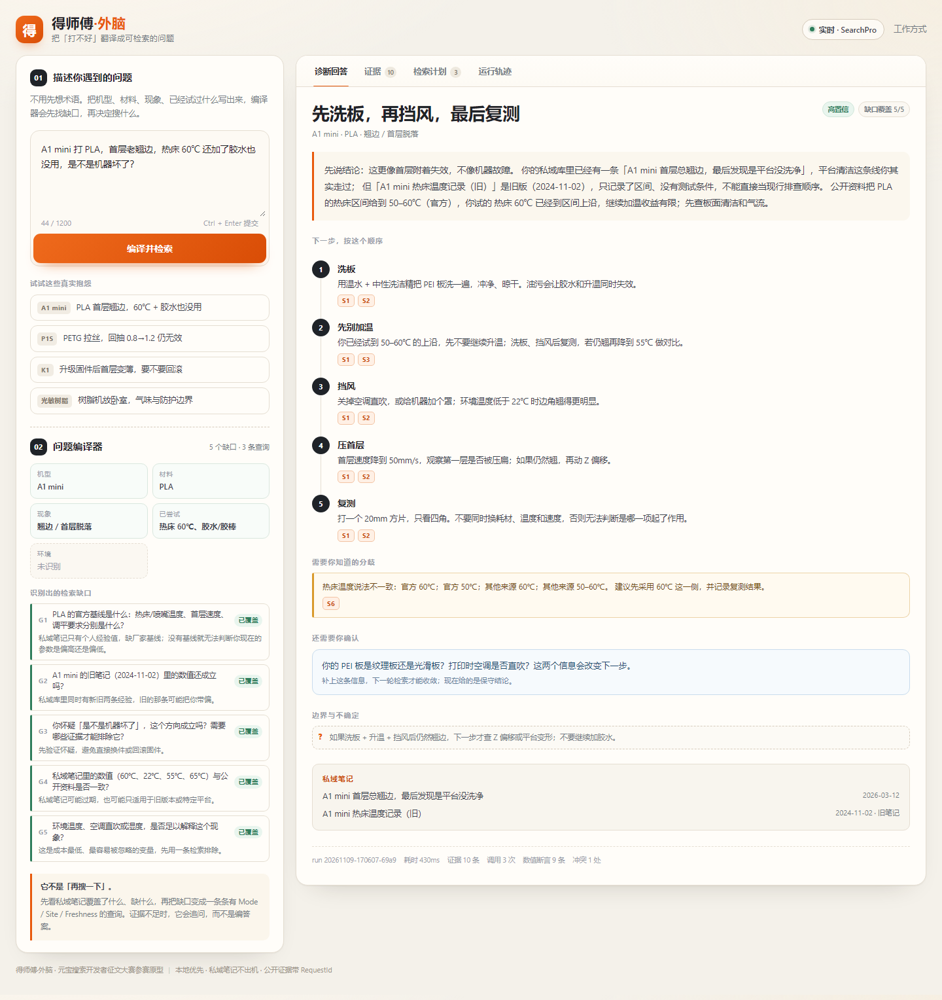

# 发布步骤（照做即可）

> 目标：把 `docs/CSDN征文.md` 发到 CSDN，满足赛事「原创 + 真实调用 + 截图 + 1500 字」四项硬要求。
> 预计 20–30 分钟。发布前不要把 `.env`、`runs/` 里的原始响应、任何 key 贴进编辑器。

## 1. 打开创作中心

1. 登录 CSDN。
2. 右上角「创作中心」→「写文章」。
3. 编辑器切到 **Markdown** 模式（若默认富文本，点工具栏的 Markdown 图标）。

## 2. 填标题与元信息

标题直接复制：

```text
【元宝搜索开发者征文大赛】把「打不好」翻译成可检索的问题：得师傅·外脑 × 元宝 SearchPro 实战
```

摘要（手动填，约 80 字）：

```text
3D 打印新手的一句抱怨，藏着五个检索缺口。我把旧项目拆成「提问编译器」：先拆槽位、找缺口，再调元宝 SearchPro 补证据，最后给出带 S 编号、冲突提示和追问的回答。文中有四个 live 案例、14 次真实调用和可复现的验证表。
```

标签建议：

```text
元宝搜索 腾讯云 RAG 3D打印 AI应用 开发者
```

分类：人工智能（或「AI 应用」）。原创声明勾选「原创」。

## 3. 粘贴正文

1. 打开 `docs/CSDN征文.md`，全选复制。
2. 粘贴到编辑器。
3. 检查标题是否重复：如果 CSDN 标题栏已填，正文第一行的一级标题可以删掉，避免出现两个标题。
4. 正文里的 4 个图片标记形如：

```markdown

```

CSDN 不能直接读取本地相对路径，**必须逐张上传替换**（下一步）。

## 4. 上传 4 张图

按正文出现顺序上传，上传后把图片拖到对应位置，删掉原来的 Markdown 图片行：

| 顺序 | 文件 | 正文位置 |
|---|---|---|
| 图 1 | `docs/screenshots/01-answer.png` | 第 0 节结论后 |
| 图 2 | `docs/screenshots/07-p1s.png` | 4.2 P1S 案例 |
| 图 3 | `docs/screenshots/05-k1.png` | 4.3 K1 案例 |
| 图 4 | `docs/screenshots/06-resin.png` | 4.4 树脂案例 |

上传后每张图下面保留图注（图 1/2/3/4 的说明文字）。若 CSDN 压图导致数字看不清，可再传 `02-evidence.png` 作为补充图，但正文 4 张已经够。

## 5. 发布前 60 秒检查

- [ ] 标题以 `【元宝搜索开发者征文大赛】` 开头。
- [ ] 正文有「赛道：模型智答与产品问答」「阶段：可演示原型」。
- [ ] 4 张图都能显示，首图顶部是「实时 · SearchPro」，不是「回放」。
- [ ] 文中没有 `sk-`、`AKI`、`.env` 内容、真实姓名/手机号。
- [ ] 有「AI 辅助说明」和「参考来源」。
- [ ] 正文字数 ≥1500（当前约 4664 个中文字，不含代码）。
- [ ] 原创声明已勾选。

## 6. 发布与提交

1. 点「发布」。
2. 回到赛事页，按页面要求提交文章链接（若页面有「提交作品」入口）。
3. 把文章链接、发布时间、截图（阅读/点赞/收藏为 0 时的初始状态）存到 `runs/publish.md`，方便 11/22 对账。

## 7. 发布后 24 小时

- 评论区置顶一条「如何复现」：

```text
复现：仓库根目录执行 python server.py --mode live --port 8765，打开 http://127.0.0.1:8765/?case=a1-warping。
没有 key 时把 --mode 改成 replay，仍能跑完整链路；文中数字、截图和 RequestId 均来自 live。
```

- 有人问「是不是套壳」时，直接指第 6 节三个 bug（covers 类型/id、SQLite 线程、Support 表格行）和 `runs/demo_check.json` 的 RequestId。
- 不要在评论区补 key、UIN、完整响应；需要看数据就发脱敏后的 `runs/demo_check.json` 字段截图。

## 8. 11/22 截止前

- 每天记录一次阅读/点赞/收藏（赛事热度按 11/22 23:59:59 数据算）。
- 不删文、不改标题；小修错别字可以，大改结构会丢推荐。
- 如果阅读低，优先发一条「3D 打印新手最容易问错的 5 个问题」短贴引流到长文，不刷量。
